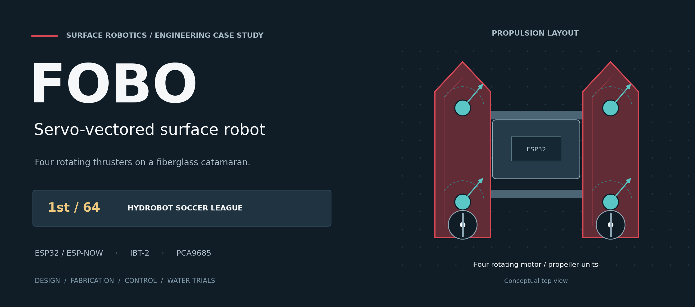
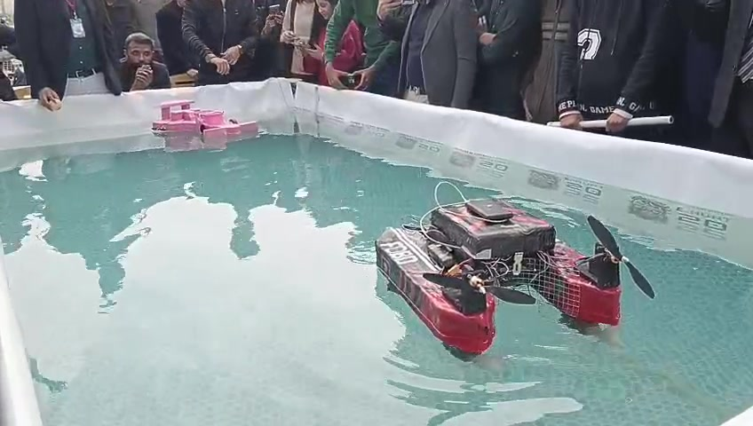
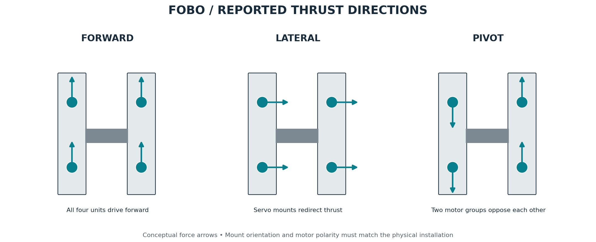

# FOBO: servo-vectored surface robot



FOBO is a remotely controlled water-soccer robot built around a fiberglass catamaran and four servo-mounted propulsion units. It combines sideways thrust vectoring with differential-thrust pivot turns. The project placed **first among 64 participating projects in the HydroBot Soccer League**.

Two ESP32 boards exchange joystick commands over ESP-NOW. Four IBT-2 drivers control the DC motors, while a PCA9685 drives the MG996R servos that redirect the propellers.

[Engineering journey](docs/build-journey.md) · [Design decisions](docs/decision-log.md) · [Photos and videos](docs/gallery.md) · [Build guide](docs/build-guide.md) · [Firmware](firmware)

## Design and development

The design had to combine precise movement and ball-pushing force within a **$150-200 planning budget**. Local component availability, motor weight and handmade actuator protection shaped the implementation.

Flat, V-shaped and twin-hull concepts were considered before selecting a catamaran. Propulsion concepts progressed from fixed units to four rotating motor mounts. XPS foam provided the initial body form, with fiberglass applied over it to form the shell. Ordinary DC motors and servos were packaged in XPS cavities using hot glue and silicone.

The [engineering case study](docs/build-journey.md) explains these choices, the construction process, the control system and the final-round servo sealing failure. The [decision log](docs/decision-log.md) follows the trade-offs behind the design.

| System | Implementation |
| --- | --- |
| Hull | XPS core with fiberglass covering; central electronics and battery bay |
| Main propulsion | Four 680 RPM DC motors and propellers on MG996R rotating mounts |
| Motor control | Four IBT-2 modules; 10 kHz, 10-bit PWM |
| Servo control | PCA9685 at 50 Hz; one shared vector command |
| Radio | ESP32 to ESP32 over ESP-NOW |
| Link timeout | 300 ms; motor stop and servo-centre commands |
| Prototype envelope | Approximately 23 × 17 × 13 in |

## Construction and water trials



The video collection follows the project from foam shaping and an early flotation check to propulsion assembly, open-water operation and the competition pool.

| Build stage | Video |
| --- | --- |
| Hull manufacture | [Foam shaping](assets/build/development/foam-shaping.mp4) · [Flotation check](assets/build/development/hull-load-check.mp4) |
| Actuator integration | [Motor packaging](assets/build/development/motor-packaging.mp4) · [Propulsion bench demonstration](assets/build/development/propulsion-bench.mp4) |
| Outdoor trials | [Launch](assets/build/development/launch-trial.mp4) · [Extended water trial](assets/build/development/open-water-trial.mp4) · [Open-water run](assets/build/development/open-water-run.mp4) |
| Competition | [Pool run](assets/build/development/competition-run.mp4) |

See the [gallery](docs/gallery.md) for construction photographs, additional operating footage and the media index.

## Motion and control



| Command | Mechanical response |
| --- | --- |
| Forward / reverse | All four main drives run in the corresponding direction |
| Left / right translation | Servos redirect the propulsion units to produce lateral thrust |
| Pivot turn | Two-motor groups drive in opposing directions |

The receiver uses CH0 for motor steering, CH1 for throttle and CH2 for servo vectoring. Steering selects the opposing-drive mode when it dominates throttle and exceeds the turn threshold. Otherwise the motors follow throttle. All four servo outputs receive the same numerical angle; mounting orientation and motor polarity determine the physical directions.

The transmitter schedules a 21-byte frame every 10 ms. Each frame carries eight channels and a CRC-8. The receiver commands zero motor PWM and centred servos when the link becomes inactive.

## Build the controller


1. Follow the [parts, power and pin maps](docs/build-guide.md).
2. Set the transmitter's `peerMac` to the receiver's Wi-Fi MAC address.
3. Upload [transmitter.ino](firmware/transmitter/transmitter.ino) and [receiver.ino](firmware/receiver/receiver.ino) to the two ESP32 boards.
4. Match motor polarity, servo orientation and travel to the physical mounts.

The reference build uses a classic ESP32 Dev Module, Arduino-ESP32 **3.3.0**, Adafruit PWM Servo Driver **3.0.3** and Adafruit BusIO **1.17.4**. The published transmitter and integrated receiver are the hardware-tested project firmware.

## Control analysis and vision extension

Calculated [motor and servo command maps](docs/analysis.md) explain the firmware's deadbands, turning logic and output limits. A separate nominal heading study uses `G(s) = 0.5 / [s(0.8s + 1)]` with PID gains `Kp=3`, `Ki=0.8`, `Kd=0.4`.


For a simulated 45° step, the model gives 33.73% overshoot and 8.90 s sampled settling time. These are simulation results. The competition firmware implements joystick RC control.

Later [YOLO/OpenCV work](docs/vision-extension.md) connected PC/laptop target detection to ESP32 commands and motor response in bench tests. Mobile-camera feedback was also explored. On-water autonomous target following is a further validation stage.

## Reproduce the figures

Use Python 3.12 from the repository root:

```bash
python -m venv .venv
# Activate the environment using your platform's command.
python -m pip install -r requirements.txt
python tools/generate_figures.py
python tools/generate_mechanical_layout.py
python tools/generate_journey_figures.py
python tools/generate_project_banner.py
python -m unittest discover -s tests -v
```

PNG and editable SVG figures are in [assets/figures](assets/figures). Calculated datasets and model parameters are in [data](data). See the [test record](docs/validation.md) and [technical references](docs/journey-sources.md) for their scope.

Maintained by [Muhammad Ahmed](https://github.com/muhammadahmedajaz). Credit to Muhammad Ahmed and his teammate for the physical project.

[Credits](docs/credits.md) · [Changelog](CHANGELOG.md) · [MIT licence](LICENSE)

