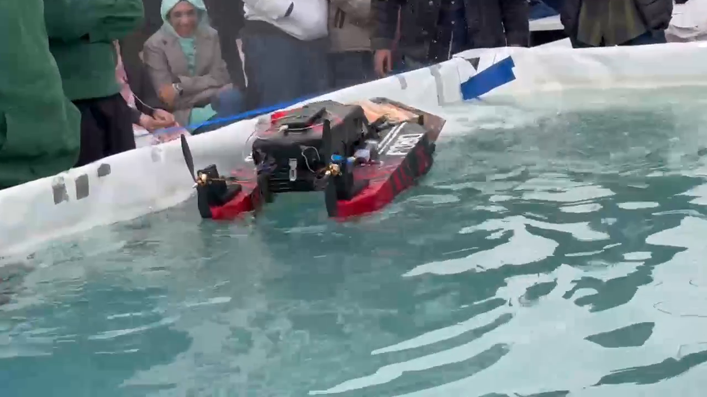
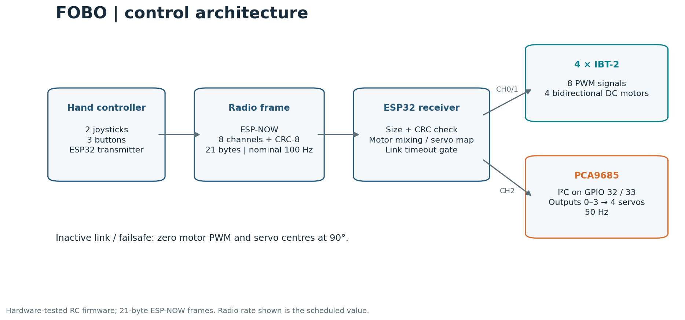
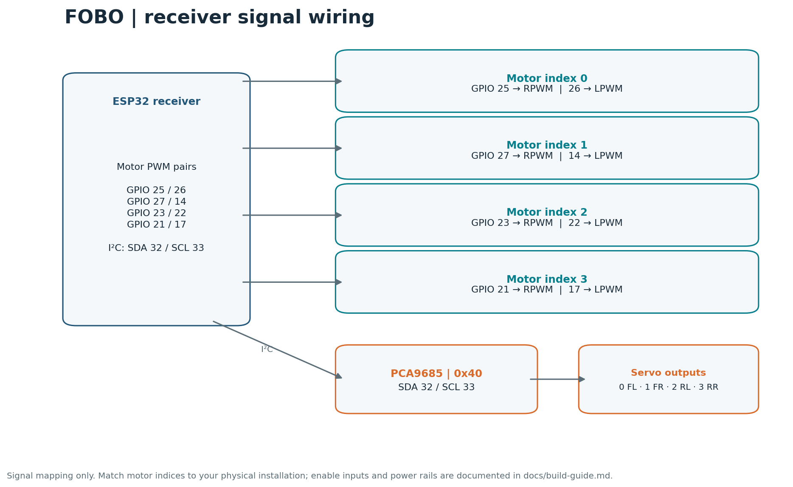
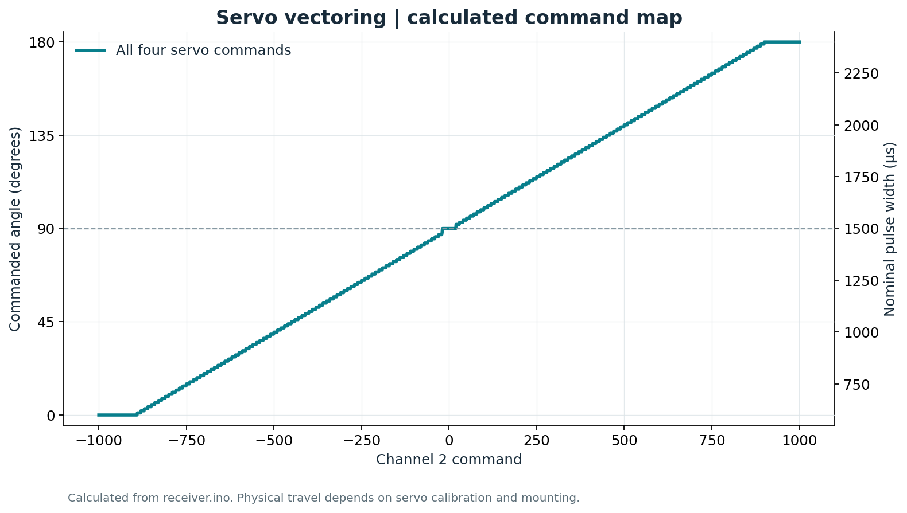
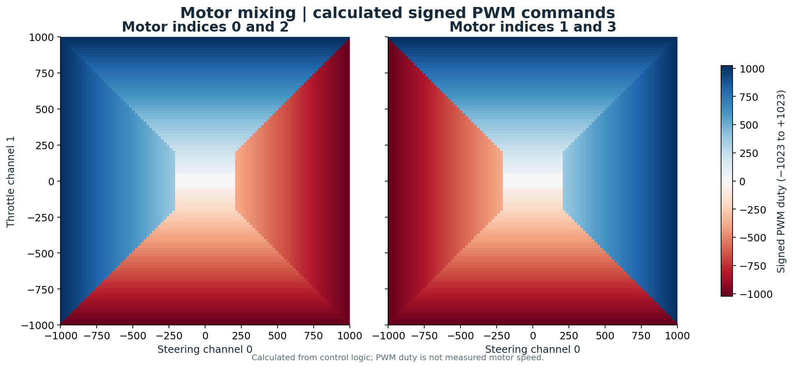
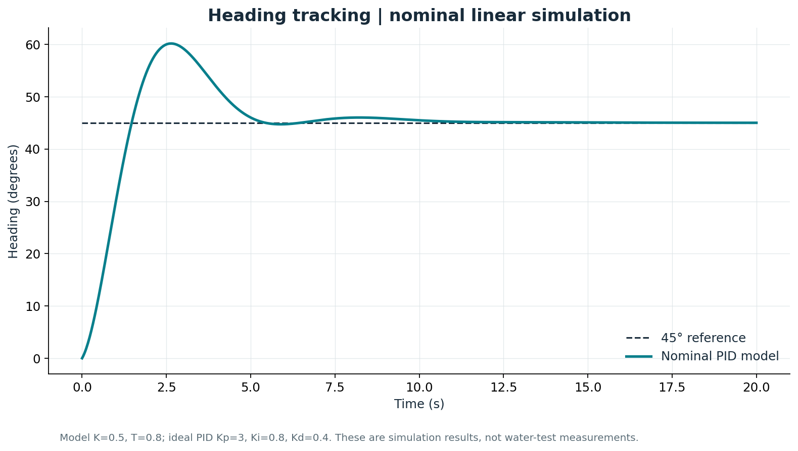
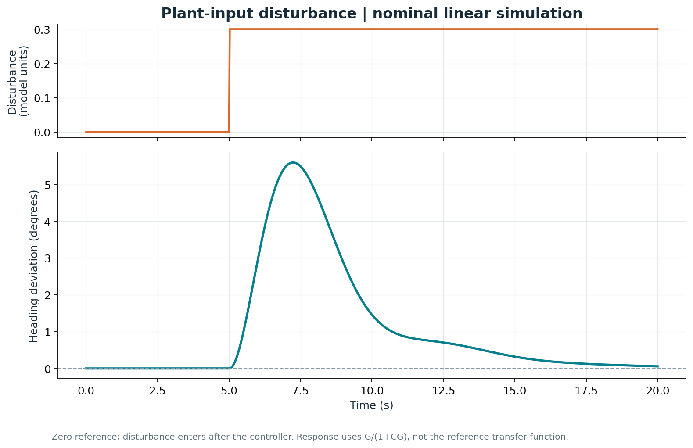

# FOBO — ESP32 surface robot

FOBO is a remotely controlled surface robot with four DC motors on servo-adjustable mounts. Two ESP32 boards exchange joystick commands over ESP-NOW; the onboard receiver drives four IBT-2 modules and a PCA9685 servo board.

**Hardware-tested controller firmware · 4 motors · 4 servo outputs · reproducible build notes and plots**



[Watch the 8-second project clip](assets/fobo-demo.mp4) · [Build guide](docs/build-guide.md) · [Radio protocol](docs/protocol.md) · [Analysis and data](docs/analysis.md)

## Hull, propulsion and fabrication

FOBO uses a fiberglass-covered XPS twin-hull body with a central electronics bay. The design evolved from fixed propulsion concepts to four motor/propeller units on MG996R servo mounts. The recorded priorities were maneuverability, stability, ball pushing and construction with locally available parts.

| Foam-stage hull and bridge | Fiberglass fabrication |
| --- | --- |
|  |  |

The [mechanical build draft](docs/mechanical-design-draft.md) collects the construction photographs, design reasoning, component layout, servo-vectoring explanation and waterproofing notes. It also identifies the missing details needed for a complete replication guide. The [report cross-check](docs/report-cross-check.md) records conflicts between the original report and the tested implementation.

More operating footage: [pool maneuvering](assets/build/pool-maneuvering.mp4), [ball approach](assets/build/pool-ball-approach.mp4), [pool soccer contact](assets/build/pool-soccer-contact.mp4), [pool/outdoor edit](assets/build/pool-and-outdoor-demo.mp4) and [outdoor edit](assets/build/outdoor-demo.mp4). The [gallery](docs/mechanical-design-draft.md#views-of-the-actual-robot) includes additional hull, rear-propeller and event views.

## Controller and analysis

The firmware is the hardware-tested source supplied by Muhammad Ahmed. The graphs below are calculated command maps and a separate nominal heading-control simulation. The PID model is not an onboard heading controller in this firmware.

## Start here

1. Build the two-board controller using the [parts, pin maps and setup instructions](docs/build-guide.md).
2. Set the transmitter's `peerMac` to your receiver's Wi-Fi MAC address.
3. Upload `firmware/transmitter/transmitter.ino` and `firmware/receiver/receiver.ino` to their respective ESP32 boards.
4. Match servo and motor directions to your mounting arrangement.

The reference compilation target is a classic ESP32 Dev Module, Arduino-ESP32 **3.3.0**, Adafruit PWM Servo Driver **3.0.3**, and Adafruit BusIO **1.17.4**. These are the repository's reference build versions; the original hardware-test environment was not recorded.

## How it works



| Input | Receiver function |
| --- | --- |
| Channel 0 / joystick 1 X | Motor steering |
| Channel 1 / joystick 1 Y | Forward/reverse command |
| Channel 2 / joystick 2 X | Servo vectoring |
| Channels 3–7 | Transmitted; not used for actuation in this receiver |

The transmitter schedules a frame every 10 ms. The packed payload is 21 bytes and carries eight channels plus CRC-8. The receiver gates actuation on link/failsafe state; its inactive branch commands zero motor PWM and 90-degree servo centres.

## Wiring



Receiver I²C is remapped to **SDA 32 / SCL 33**, avoiding motor outputs on GPIO 21 and 22. The figure shows signal assignments from the source. Power rails, enable pins and the transmitter wiring are covered in the [build guide](docs/build-guide.md).

## Servo vectoring



The supplied receiver commands all four PCA9685 outputs with the same angle: `90 + offset`, constrained to 0–180°. Physical rotation depends on the mounting. Comments describing opposite rear-servo offsets do not match those expressions; the tested source has been preserved.

`SERVO_MAX_OFFSET = 100` requests more than the ±90° available around the centre, so the ends clip. The source maps angle commands to 600–2400 µs at 50 Hz. The graph describes commands, not measured shaft angles.

## Motor mixing



Steering selects an opposite-direction turning mode when it dominates throttle and exceeds 200 channel units. Otherwise all motors follow throttle. The map shows signed 10-bit PWM duty for motor groups 0/2 and 1/3; it is not a speed or thrust measurement.

## Heading-control study



The separate analysis uses `G(s) = 0.5 / [s(0.8s + 1)]` and ideal PID gains `Kp=3`, `Ki=0.8`, `Kd=0.4`. These nominal model parameters were not identified from water-test logs.

| Nominal simulation result | Value |
| --- | --- |
| Reference heading | 45° |
| Overshoot | 33.73% |
| Sampled 2% settling time | 8.90 s |
| Sample interval / horizon | 0.025 s / 20 s |

These values describe this model and reference step, not the physical robot's measured performance.



The disturbance plot uses `G/(1+CG)` for a disturbance added at the plant input. See [analysis notes](docs/analysis.md) for the equations, the MATLAB correction and the Simulink derivative-filter difference.

## Reproduce the graphics and inspect the data

Use Python 3.12 from the repository root:

```bash
python -m venv .venv
# Activate the environment using your platform's command.
python -m pip install -r requirements.txt
python tools/generate_figures.py
python -m unittest discover -s tests -v
```

Every chart is generated from source-derived parameters or the included nominal heading model. PNG and editable SVG figures are stored in `assets/figures/`.

| Dataset | Meaning |
| --- | --- |
| [Servo map](data/servo_command_map.csv) | Calculated channel → angle → pulse → PCA tick mapping |
| [Motor map](data/motor_command_map.csv) | Calculated steering/throttle → signed PWM mapping |
| [Heading response](data/heading_step_response.csv) | Nominal simulated reference tracking |
| [Disturbance response](data/disturbance_rejection.csv) | Nominal simulated heading deviation |
| [Parameters](data/parameters.json) | Values read from source and receiver SHA-256 |
| [Simulation metrics](data/simulation_metrics.json) | Calculated metrics and closed-loop poles |

## Project notes

- Controller firmware has been hardware-tested, as confirmed by Muhammad Ahmed.
- FOBO placed first among 64 teams in the HydroBot Soccer League, a team achievement.
- The clip demonstrates the surface platform. It is not a time-synchronised firmware validation log.
- This repository contains RC control and a separate simulation study. Vision/autonomy extension scripts are not included.

Maintained by [Muhammad Ahmed](https://github.com/muhammadahmedajaz). Credit to Muhammad Ahmed and his teammate for the physical project. Third-party libraries retain their own licences; see [credits](docs/credits.md).

[Changelog](CHANGELOG.md) · [Reproduction and test record](docs/validation.md) · [MIT licence](LICENSE)

