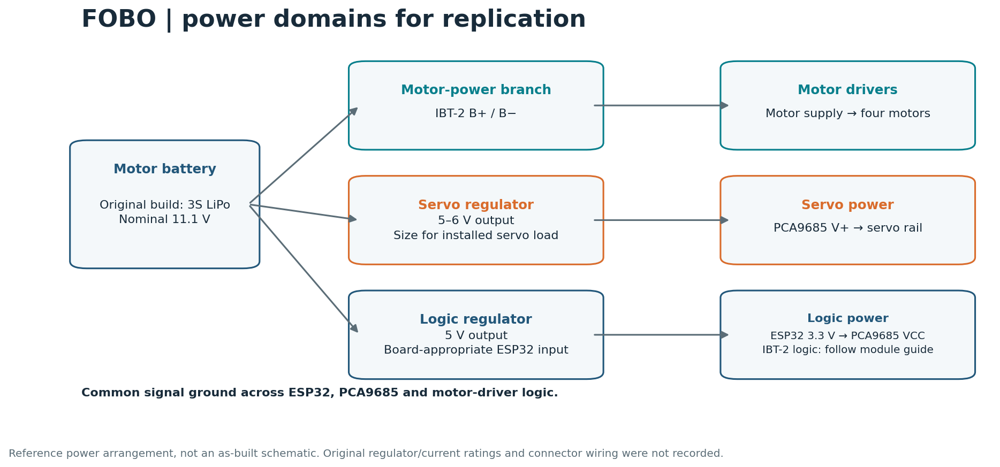

# Build and setup guide

This guide documents the hardware-tested controller implementation. Use the exact signal maps below and match the motor/servo installation to your own hull.

For the physical structure and motion, see [design and construction](mechanical-design.md), the [XPS/glue/silicone packaging method](waterproofing.md), and the [photo/video gallery](gallery.md). Version details are covered in the [implementation notes](report-cross-check.md).

## Parts

| Quantity | Item | Notes |
| --- | --- | --- |
| 2 | Classic ESP32 development boards | Transmitter and onboard receiver; reference target ESP32 Dev Module |
| 2 | Two-axis analogue joysticks | Four axes total; power from 3.3 V for ESP32 ADC inputs |
| 3 | Momentary buttons | Inputs use pull-ups and switch to GND |
| 4 | IBT-2 / dual-BTS7960 motor-driver modules | Two PWM inputs per motor |
| 4 | 680 RPM DC gearmotors with propellers | Motor-selection reference: JGB37-550 12 V / 680 RPM; select propellers for the installed motor and load |
| 1 | PCA9685 PWM/servo driver | Default address 0x40 |
| 4 | MG996R servo motors | Motor-mount vectoring in the original project |
| 1 | Suitable motor battery | Original project record lists a 3S, 2200 mAh LiPo |
| As required | Regulated logic and servo supplies | Select current capacity for the installed hardware |
| As required | Hull, servo mounts, wiring and connectors | Match mounts and wiring to the hull installation |
| As required | XPS foam and fiberglass materials | Shape the foam form before applying fiberglass; choose a compatible resin/cloth system |
| As required | Hot glue and silicone | Used around motors and servos in XPS packaging; one servo suffered water ingress in the final round |

## Transmitter connections

| Input | ESP32 GPIO | Radio channel |
| --- | --- | --- |
| Joystick 1 X | 34 | 0 |
| Joystick 1 Y | 35 | 1 |
| Joystick 2 X | 32 | 2 |
| Joystick 2 Y | 33 | 3 |
| Button 1 | 25 | 4 |
| Button 2 | 26 | 5 |
| Button 3 | 27 | 6 |

Connect joystick supply and signal ground to the transmitter's 3.3 V/GND. Each button connects its input to GND when pressed. Channel 7 is reserved.

The code linearly maps ADC values 0–4095 to −1000–1000. It does not store a per-joystick centre/end-point calibration. Check the serial channel values to establish your joystick orientation and centre.

## Receiver motor signals

| Motor index in code | IBT-2 RPWM | IBT-2 LPWM |
| --- | --- | --- |
| 0 | GPIO 25 | GPIO 26 |
| 1 | GPIO 27 | GPIO 14 |
| 2 | GPIO 23 | GPIO 22 |
| 3 | GPIO 21 | GPIO 17 |

The identifiers ending in `_DIR` in the source are used as the second PWM input, not a single direction pin. The source uses 10 kHz, 10-bit PWM.

The code does not establish which motor index is physically front-left, front-right, rear-left or rear-right. Record that mapping when assembling your hull. The turning groups are indices 0/2 and 1/3.

For the common IBT-2 module described in the [HandsOn user guide](https://www.handsontec.com/dataspecs/module/BTS7960%20Motor%20Driver.pdf): VCC is the module's 5 V logic supply, B+/B− are motor power, and M+/M− connect to the motor. R_EN and L_EN are active-high enable inputs. This firmware does not allocate GPIOs to those enables; they must be enabled by the module's external wiring. R_IS/L_IS are not used by this firmware. Check the labels and requirements of your particular module.

## PCA9685 and servo signals

| Connection | Setting |
| --- | --- |
| ESP32 GPIO 32 | PCA9685 SDA |
| ESP32 GPIO 33 | PCA9685 SCL |
| ESP32 3.3 V | PCA9685 VCC / logic rail |
| Signal ground | PCA9685 GND |
| Regulated servo supply | PCA9685 V+ / servo power rail |
| PCA9685 output 0 | Servo labelled FL |
| PCA9685 output 1 | Servo labelled FR |
| PCA9685 output 2 | Servo labelled RL |
| PCA9685 output 3 | Servo labelled RR |

The receiver runs the PCA9685 at 50 Hz and centres outputs at 90°. Its 600–2400 µs limits are settings from the tested project code. Match pulse limits, physical orientation and available travel to the actual servos and mounts you install.

All four outputs receive the same angle command in this source. Opposite physical motion can result from mirrored mounting; do not change signs solely from the existing rear-servo comments.

## Power domains



This reference power arrangement separates motor, servo and logic supplies. Choose regulator ratings and wiring for the installed loads.

Keep the PCA9685's VCC logic rail at the ESP32's 3.3 V level. Its separate V+ rail supplies the servos and normally uses a regulated 5–6 V supply appropriate for the servos. Join signal grounds. The 3S motor battery must not feed the servo rail directly. Size the servo supply for simultaneous servo loads rather than the PCA9685 logic current. See [Adafruit's power-pin guide](https://learn.adafruit.com/16-channel-pwm-servo-driver/pinouts) and [wiring guide](https://learn.adafruit.com/16-channel-pwm-servo-driver/hooking-it-up).

## Reference software configuration

| Component | Reference version |
| --- | --- |
| Arduino-ESP32 core | 3.3.0, based on ESP-IDF 5.5.0 |
| Board FQBN | esp32:esp32:esp32 |
| Adafruit PWM Servo Driver Library | 3.0.3 |
| Adafruit BusIO | 1.17.4 |
| Python analysis environment | Python 3.12; packages pinned in requirements.txt |

The transmitter uses `esp_now_send_info_t`, matching the ESP-IDF 5.5 callback API. Older ESP32 core releases can fail on that signature. The receiver uses the 3.x pin-based LEDC API. Use this reference configuration for reproducible compilation.

### Arduino IDE

1. Add `https://espressif.github.io/arduino-esp32/package_esp32_index.json` in Additional Boards Manager URLs.
2. Install ESP32 core 3.3.0 and select ESP32 Dev Module for a compatible classic board.
3. Install the Adafruit PWM Servo Driver library 3.0.3 and Adafruit BusIO 1.17.4.
4. Flash `examples/receiver_mac/receiver_mac.ino` to the intended receiver and read its MAC in Serial Monitor at 115200 baud.
5. Edit the transmitter's `peerMac` array to that MAC. Its included address belongs to the original project receiver.
6. Flash the main receiver to that board and the transmitter sketch to the handheld board.

### Arduino CLI

```bash
arduino-cli core update-index --additional-urls https://espressif.github.io/arduino-esp32/package_esp32_index.json
arduino-cli core install esp32:esp32@3.3.0 --additional-urls https://espressif.github.io/arduino-esp32/package_esp32_index.json
arduino-cli lib install "Adafruit BusIO@1.17.4"
arduino-cli lib install "Adafruit PWM Servo Driver Library@3.0.3" --no-deps
arduino-cli compile --fqbn esp32:esp32:esp32 firmware/transmitter
arduino-cli compile --fqbn esp32:esp32:esp32 firmware/receiver
```

Compilation does not upload firmware. Select the actual serial port before using an upload command.

## Bring-up and troubleshooting

| Observation | Check |
| --- | --- |
| No received frame IDs | Receiver MAC in peerMac, matching radio channel, flashed roles and serial output |
| Motor does not respond | Module enables, motor supply, common ground, correct RPWM/LPWM pair and throttle deadband |
| Unexpected turn direction | Physical motor index grouping and installed motor polarity |
| Servo board does not respond | SDA 32 / SCL 33, 0x40 address, 3.3 V logic and signal ground |
| ESP32 resets when servos move | Regulator capacity, servo supply wiring and shared ground path |
| Servo direction seems reversed | Physical mount orientation and the actual same-angle expressions |
| Compile error on ESP-NOW callback or LEDC | ESP32 core version; do not mix 2.x examples with the reference 3.3.0 API |

The receiver prints link, failsafe, frame ID and channels every 200 ms. The transmitter prints send-submission status; that return value is not a measured radio latency or delivery-rate report.

For the first powered check, support the mechanism so moving parts cannot catch anything and keep propellers unloaded. This is an assembly check for your build; the supplied project firmware itself has already been hardware-tested.

