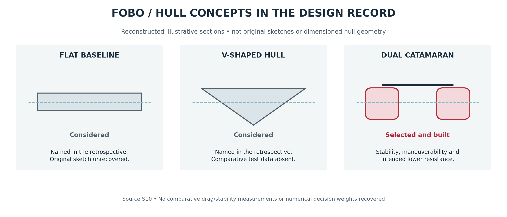
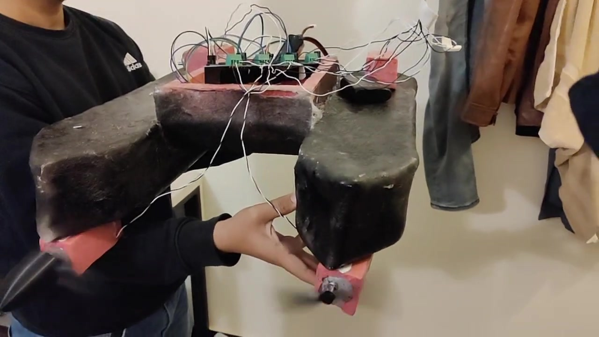
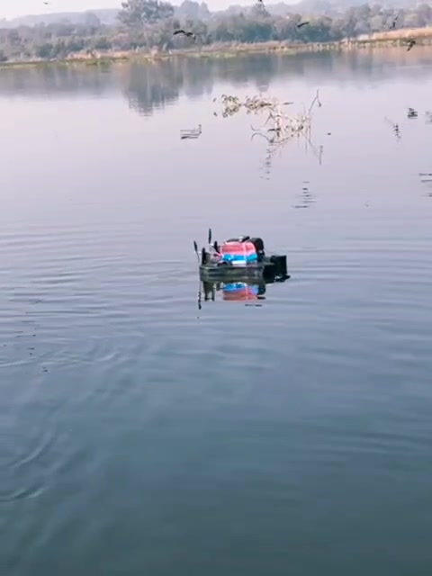

# FOBO engineering case study

FOBO was developed for water soccer, where a robot must approach a ball, change direction around opponents and generate enough force to push toward a goal. The project combined a fiberglass catamaran, four rotating propulsion units and an ESP32 wireless controller. It placed first among 64 participating projects in the HydroBot Soccer League.

The design problem extended beyond making a boat move forward. Directional control, torque and precise positioning had to fit a small budget and the components available locally. Those constraints shaped the hull, propulsion and actuator protection.

## Design brief and practical constraints

The November 2025 planning discussions centred on directional control, torque, precision and speed. A $150-200 planning budget limited the use of commercial underwater thrusters and advanced control hardware. Component selection therefore had to account for availability as well as nominal performance.

Early options included commercial propulsion, a separate lateral actuator and more elaborate control hardware. Water pumps were also considered as a proposed solution. The design direction settled on ordinary DC motors, servo-adjustable mounts and a simpler controller.

A preliminary mass of 3.2 kg was used during planning. The four selected propulsion motors alone represented approximately 1.2 kg, at about 300 g each. Lighter, higher-thrust underwater alternatives exceeded the budget. The assembled platform was later described at approximately 4.5-5 kg, including a bare body of about 2.5 kg.

## Hull selection

Flat, V-shaped and dual-catamaran concepts were considered against maneuverability, stability, cost, weight, thrust capability and fit to the game.

The selected catamaran used two hulls connected by a bridge, with the electronics and battery near the centre. Stability during directional changes and the intended reduction of water resistance were part of the selection rationale. The bridge also provided a location for the central compartment while the propulsion units occupied the corners.

The prototype envelope was approximately 23 × 17 × 13 in. The dimensions describe the built platform, with roughly 1-2 in of variation. Mounts were integrated with the fiberglass structure, with wooden inserts and adhesive also used.

### Shaping the body before applying fiberglass

The body began as shaped XPS foam. This established the hull outline and bridge before the fiberglass shell was applied. The construction footage shows manual shaping and sanding of the foam.

| XPS body form | Fiberglass work |
| --- | --- |
|  |  |

The construction account specifies three basic fiberglass layers, with additional reinforcement reaching six layers locally around curved regions. The central bay housed the electronics and battery.

[Watch foam shaping](../assets/build/development/foam-shaping.mp4) · [Watch the early flotation check](../assets/build/development/hull-load-check.mp4)

The flotation footage shows the hull supporting a container load during an early water check.

## Propulsion: changing the direction of thrust

The concept developed from two thrusters with a separate turning mechanism to four fixed units, then to four servo-rotatable propulsion units. The final arrangement gave the main propulsion system a way to redirect thrust as well as reverse it.

Each unit has two distinct functions. A DC motor drives the propeller, while an MG996R servo rotates the motor mount. Redirecting the unit changes the direction of the thrust acting on the hull.

[Watch the propulsion bench demonstration](../assets/build/development/propulsion-bench.mp4)

The four main units use 680 RPM DC motors. The motor-selection discussion compared a 25GA-370 12 V / 1360 RPM candidate with a JGB37-550 12 V / 680 RPM option. A roughly 6 kgf total thrust target was discussed, along with a 6 × 4E propeller available during development.

Nominal RPM was only part of that comparison. Motor torque, propeller loading and the mass of four units also affected the choice. The 680 RPM motors became part of the physical build. The thrust figures discussed during component selection were planning estimates.

### Translation and pivot turning

| Motion | Mechanism |
| --- | --- |
| Forward | All four main propulsion units drive forward |
| Reverse | All four reverse their drive direction |
| Left or right translation | Servo mounts redirect the units to produce lateral thrust |
| Pivot turn | Two-motor groups drive in opposing directions |

These motions combine vectored thrust with differential-thrust turning. In planar motion, they correspond to surge, sway and yaw.

The mechanical arrangement and controller have to be considered together. The receiver commands the four servos with one shared numerical angle. Mount orientation and motor polarity establish the corresponding physical directions.

### Separating maneuvering from ball-pushing force

Two raised rear propellers were added for stronger forward pushing. The design also intended them to provide some continued capability if a main thruster failed.

This addressed a different demand from directional positioning. The four lower units provided the main maneuvering mechanism; the rear boosters added a dedicated pushing contribution. The published four-IBT-2 receiver controls the four main DC propulsion units.

## Protecting ordinary motors and servos

Commercial underwater propulsion exceeded the available budget, so ordinary motors and servos required custom protection.

An early motor-pod proposal used a tube, shaft supports and multiple sealing interfaces. That approach was considered too complex for the build. A simpler arrangement used motor-sized and servo-sized cavities in XPS foam, filled and sealed with hot glue and silicone.

[Watch the packaged motor](../assets/build/development/motor-packaging.mp4)

For each DC motor, the foam surrounded the body while the shaft remained outside to drive the propeller. The servos were installed in matching cavities and sealed around their bodies. This adapted inexpensive components to the water environment while retaining the rotating propulsion mechanism.

### Final-round sealing failure

During the final round, water entered one servo and it stopped working. The arrangement otherwise supported operation through the project.

The failure identifies actuator protection as a design issue alongside propulsion performance. A rotating mount introduces interfaces that must continue to function while exposed to water. The next enclosure revision should prioritise serviceable seals and repeated operating exposure checks. The [waterproofing notes](waterproofing.md) describe the construction method and the observed failure.

## ESP32 controller integration

The control system uses a handheld ESP32 transmitter and an onboard ESP32 receiver. Joystick channels travel over ESP-NOW in a packed frame with CRC-8 checking.

Four IBT-2 modules drive the main motors through RPWM/LPWM pairs. A PCA9685 at address 0x40 provides the four servo outputs. Its I²C bus uses GPIO 32 and 33, keeping it separate from motor outputs on 21 and 22.

| Input or state | Receiver behavior |
| --- | --- |
| CH0 steering | Selects opposing-drive turning when steering dominates throttle and exceeds the threshold |
| CH1 throttle | Commands common forward/reverse drive outside turning mode |
| CH2 vector command | Sets the shared angle for the four servo outputs |
| Inactive link / failsafe | Commands zero motor PWM and centred servos |

The transmitter schedules frames at 10 ms intervals. The receiver's hard failsafe timeout is 300 ms. Motor PWM is 10 kHz at 10-bit resolution, while the servo driver runs at 50 Hz.

The hardware-tested transmitter and integrated receiver form the implementation reference. [Signal maps, power guidance and upload instructions](build-guide.md) support replication. The [protocol description](protocol.md) explains the packet format and command semantics.

## Water trials and competition

The development footage follows the platform into open water and the competition pool. It includes a launch beside a jetty, extended outdoor operation and interaction in the event pool.

| Outdoor operation | Competition pool |
| --- | --- |
|  |  |

[Launch](../assets/build/development/launch-trial.mp4) · [Extended water trial](../assets/build/development/open-water-trial.mp4) · [Open-water run](../assets/build/development/open-water-run.mp4) · [Competition run](../assets/build/development/competition-run.mp4)

The competition platform was remotely controlled. Its first-place finish among 64 participating projects is a team result, alongside the engineering experience gained in fabrication, actuator integration and operation on water.

## Camera feedback and control analysis

The December 2025 extension discussions explored practical Python functionality under a short time constraint. Timed trajectory control was considered first. Camera feedback offered a way to observe a target and adjust movement from an image.

The proposed mobile-camera approach included tracking a visible point, sending commands to the receiver and stopping on target loss. That experiment was narrowed to motor-only control. A direct phone command interface required a different receiver input path from the ESP-NOW joystick link.

Later PC/laptop YOLO/OpenCV work bench-tested target detection, ESP32 command transmission and motor response. Autonomous following in water is a further validation stage. The [vision extension](vision-extension.md) describes this work separately from the competition controller.

The project also includes a nominal MATLAB/Python yaw-control study. Its assumed plant and PID gains support analysis of heading response and disturbance rejection. The [simulation results](analysis.md) are labelled separately from the physical platform.

## Engineering outcomes

The project linked hull fabrication, motor selection, mechanical vectoring and wireless control within a limited budget. Decisions in one area affected the others: obtainable motors contributed substantial mass, rotating mounts added servo and sealing requirements, and ball pushing led to the rear booster arrangement.

| Workstream | Outcome |
| --- | --- |
| Surface platform | Built and operated in outdoor and competition water trials |
| Competition | First among 64 HydroBot projects |
| RC controller | Hardware-tested ESP32 transmitter and integrated motor/servo receiver |
| Actuator packaging | XPS, hot glue and silicone implementation; one servo ingress failure in the final round |
| Vision extension | Detection, ESP32 commands and motor response bench-tested |
| Heading control | Separate nominal simulation study |

[Design decisions](decision-log.md) · [Mechanical design](mechanical-design.md) · [Gallery](gallery.md) · [Technical references](journey-sources.md)
