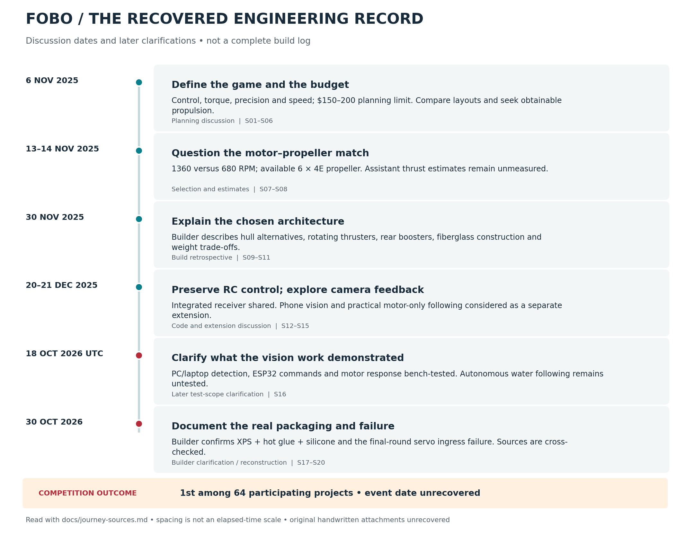

# FOBO: the engineering journey

FOBO began as a water-soccer design problem: move accurately around opponents, approach a ball, and push it toward a goal using parts the team could afford and obtain locally. Muhammad Ahmed and his teammate built the resulting surface robot around a fiberglass-covered XPS catamaran, four servo-mounted DC thrusters and ESP32 radio control. The team placed **first among 64 participating projects in the HydroBot Soccer League**.

The useful part of this history is how those choices were reached. The discussions move between the whole robot and individual constraints: hull shape, motor weight, propeller load, the price of underwater hardware, sealing a moving actuator, and the difference between an attractive calculation and a demonstrated result.

This account was reconstructed on 30 October 2026 from recovered build discussions, the supplied project report, real photographs and footage, the preserved firmware, and Ahmed's later clarification. **6 November 2025 is the earliest dated discussion recovered, rather than a verified project start date.** Dates below identify discussions or records; they do not date an undocumented fabrication step. The [source register](journey-sources.md) explains the coverage, including the original handwritten pages that have not yet been recovered.

## 1. Start with the game, then choose the machine

On **6 November 2025**, Ahmed was comparing a rectangular and square footprint for a dual-hull robot. He described a two-square-foot footprint limit and asked for a design with “great directional control plus torque and precision with speed.” The purpose was specific: dodge opponents and take the ball toward the goal. [S01–S03](journey-sources.md#s01-s05)

That question establishes the design priorities at the time. Straight-line speed was one objective among several. The machine also needed to change direction, line up with the ball, and continue pushing after contact. These demands explain why the later design gave so much attention to the direction of thrust.

The first assistant proposal was a **24 × 12 in rectangular catamaran**, with two narrow hulls, a proposed draft and a rough buoyancy calculation. Another suggestion introduced relatively powerful commercial thrusters, a lateral actuator, advanced control hardware and additional sensing. These were design suggestions. They were not the dimensions, purchased parts or control system of the final robot.

Ahmed then stated a **$150–200 maximum budget** and pushed the discussion toward equipment that could actually be obtained. He rejected advanced-controller/ESC proposals outside that constraint, said suitable waterproof motors were unavailable to him, and proposed four corner motors that could rotate on servos. Water pumps were also rejected as the proposed propulsion solution. He asked to establish the design and weight before continuing the motor search. [S03–S05](journey-sources.md#s01-s05)

The documented pattern is practical: state what the robot must do, challenge a proposal that does not fit the budget, then return to the mass and actuation requirements. The $150–200 figure is a planning constraint; an itemized final expenditure has not been recovered.

## 2. Choosing the hull and the supporting structure

In his **30 November design retrospective**, Ahmed identified three hull concepts that had been studied: a flat baseline platform, a V-shaped hull and a dual catamaran. The recorded selection criteria were maneuverability, stability, cost and availability, weight, thrust capability and fit to the game. The catamaran was chosen for that combination of requirements, including the intended reduction of water resistance. [S09–S10](journey-sources.md#s09-s11)

The paired hulls were joined by a bridge with the electronics and battery compartment near the centre. The construction account describes fiberglass-integrated mounts, with wooden inserts and adhesive also used. This is the recovered structural arrangement; there is no complete dimensioned frame drawing in the archive.

There are no comparable drag, stability or maneuvering measurements for the rejected hulls. The old report's categorical claims that one shape had more drag or insufficient stability go beyond the recovered evidence. The selection can be explained through the team's objectives without assigning invented scores or claiming that every alternative was manufactured and tested. The [decision log](decision-log.md#d02--hull-and-structure) records that distinction.

### From foam shape to fiberglass body

| First physical form: shaped XPS | Fiberglass applied over the form |
| --- | --- |
|  |  |

Ahmed confirmed the sequence directly: **shape the body in XPS first, then apply fiberglass over it**. Earlier build notes describe three basic layers, reaching six locally in curved regions. The photographs preserve the foam stage and the fiberglass work; they are not a dated log of every layer. Resin formulation, cloth weight and curing conditions remain unrecorded. [S09, S17, S19](journey-sources.md)

The approximate finished envelope is **23 × 17 × 13 in**, with Ahmed reporting roughly 1–2 in of variation. The November account gives about **2.5 kg for the bare body** and **4.5–5 kg equipped**. Those later mass figures are substantially above the **3.2 kg planning mass** discussed on 6 November. The records establish a difference between the early target and later reported build; they do not provide a mass breakdown that explains every increment.

Requirements also need to remain traceable. An early two-square-foot footprint constraint, a later statement of an 18 in cube, and the approximate final dimensions do not agree as a single compliance specification. No official rule revision or inspection sheet has been recovered. The repository publishes the prototype dimensions and leaves the rule discrepancy visible rather than claiming that a 23 in body fits an 18 in limit.

## 3. Propulsion changed because the required motions changed

Ahmed's November retrospective describes the concept progression as **two thrusters with a separate turning mechanism → four fixed thrusters → four servo-rotatable thrusters**. Four rotating corner units had already appeared as an idea in the 6 November discussion. These records establish concept development; they do not date three separately built prototypes. [S03, S10](journey-sources.md)

The final mechanism separates two tasks:

| Component | Job in the mechanism |
| --- | --- |
| DC motor and propeller | Produce thrust |
| MG996R servo and rotating mount | Redirect that thrust |
| Motor drive grouping | Reverse propulsion or produce an opposing-thrust pivot |

This arrangement lets the robot approach movement as more than a forward motor plus a steering correction. Ahmed reports forward and reverse movement with all four drives, sideways movement by redirecting the mounts, and pivoting with two-motor groups running in opposing directions. The mechanism combines **vectored thrust** with **differential-thrust turning**. [S17](journey-sources.md#s17)

The four primary propulsion units use **680 RPM DC motors and four propellers**. Each motor was reported as approximately **300 g**, about **1.2 kg for four**, before any separate, unrecorded breakdown of mounts and packaging. Ahmed had researched lighter, high-thrust underwater motors, but they exceeded the available budget. The design therefore had to accommodate the mass of obtainable motors. [S10, S17](journey-sources.md)

### Why add the raised rear propellers?

Ahmed described the two rear boosters as an answer to insufficient forceful ball pushing from the four lower thrusters, with continued capability if a thruster failed as a second intention. This identifies a separate gameplay demand: directional maneuvering and forceful pushing were both important. [S10](journey-sources.md#s09-s11)

The raised rear propellers are visible in the operating footage. Their exact motors, propeller dimensions and control wiring have not been recovered. No controlled before/after pushing-force test establishes the improvement, and the fallback idea has no recorded fault-injection test. The four-IBT-2 receiver in this repository should not be read as a complete wiring description for those boosters.

## 4. Choosing a motor meant questioning RPM and propeller estimates

On **13 November**, the discussion compared a **12 V 25GA-370, 1360 RPM** candidate with a **JGB37-550, 12 V, 680 RPM** option. Ahmed asked whether the motor could supply the required thrust and clarified a roughly **6 kgf total thrust goal**. This was a design target, not a scale measurement. The slower 680 RPM option became the recorded selection discussion; Ahmed later confirmed that the built robot used 680 RPM motors. The exact installed nameplate is not photographed in the recovered evidence. [S07](journey-sources.md#s07-s08)

On **14 November**, Ahmed said he had a **6 × 4E propeller** and asked for a thrust estimate. That identifies a real candidate available during development. It does not establish that this exact propeller was fitted to every final underwater unit. [S08](journey-sources.md#s07-s08)

The assistant supplied several thrust estimates, revised them, and recommended in-water testing. Those numbers depended on assumed torque, loading and efficiency. The archive contains no corresponding thrust/current/RPM measurements. They are retained as part of the advice history in the [source audit](journey-sources.md#what-the-assistant-contributed-and-what-was-corrected), rather than promoted into FOBO's performance specification.

For someone repeating the build, the unresolved engineering question is the loaded motor–propeller combination. A nominal RPM label and propeller diameter do not establish delivered thrust. The next measurement should record the actual propeller, supply voltage, current, loaded RPM and thrust together. That is a proposed improvement to the evidence, not a test claimed for the original team.

## 5. Making ordinary actuators survive the water

The same cost constraint shaped waterproofing. On **6 November**, the assistant described a relatively elaborate motor pod with a tube, shaft supports, seals and enclosure interfaces. Ahmed rejected the complexity and asked for a simpler implementation. A bottle/PVC housing was then suggested. **The actual method was different**, as Ahmed later clarified. [S06, S17](journey-sources.md)

For each motor, he made a motor-sized space in XPS, put the motor inside with only its shaft outside the foam, and filled/sealed around the body using **hot glue and silicone**. The servos went into servo-sized XPS cavities and were sealed with glue and silicone as well.

This was a direct adaptation of ordinary available components to the project environment. It avoided buying complete underwater thrusters, while leaving the protection dependent on the handmade enclosure and its moving interfaces. A separate lip seal, gland assembly or O-ring system is not established by the recovered construction account.

### The final-round servo failure

Ahmed reports that **water entered one servo and it stopped working during the final round**. He says the packaging otherwise worked well through the project. The exact entry path—case, cable or rotating output—was not diagnosed in the recovered record. No repair sequence or post-failure teardown has been recovered. [S17](journey-sources.md#s17)

This belongs beside the competition result. The robot achieved useful operation and won the event, while one sealing method also reached an observed failure. The practical lesson for a successor is to isolate and verify the actuator interfaces, record exposure duration, and inspect for ingress after repeated operation. Those are retrospective recommendations; the old report's claim of complete waterproofing has been corrected.

The report also lists fiberglass rework, silicone bubbles, wire-routing difficulty and mount alignment as manufacturing challenges. These have not been independently recovered as dated user reports, so they remain [report-only leads](journey-sources.md#report-only-manufacturing-leads), rather than reconstructed scenes in the build story.

## 6. Turning the mechanism into a repeatable controller

The integrated receiver was present in a **20 December 2025** discussion. The supplied hardware-tested source combines ESP-NOW reception, CRC-8 checking, four IBT-2 motor outputs, PCA9685 servo commands and a 300 ms link-loss timeout. The code's appearance on that date establishes that the implementation was being discussed then; it is not an exact commissioning date. [S12, S20](journey-sources.md)

The controller exposes the practical command structure:

| Input | Preserved receiver behavior |
| --- | --- |
| CH0 | Selects opposing-drive turning when steering dominates throttle and exceeds the threshold |
| CH1 | Drives all four motors forward/reverse outside that turning mode |
| CH2 | Sends the same numerical vector angle to all four PCA9685 servo outputs |
| Link inactive / failsafe | Commands zero motor PWM and servo centres in the main loop |

I²C was assigned to **GPIO 32/33**, avoiding motor output pins 21/22. The archived source makes that arrangement reproducible. It does not preserve a dated account of the original pin-conflict debugging, so no such debugging episode is invented here.

There is also an important mechanical/control boundary. Although the robot has four rotating mounts, the archived receiver does not command four independent angles. All four expressions use `90 + offset`; physical mounting and motor polarity determine the corresponding directions. A comment suggesting opposite rear offsets disagrees with those expressions. The hardware-tested source is preserved, and the discrepancy is explained in the [build guide](build-guide.md) and [command analysis](analysis.md).

The November electronics discussion mentions an **L298N**, a 3S 2200 mAh battery and regulator-powered servos. The later supplied implementation uses **four IBT-2 modules**. Both records are retained; the precise changeover date and reason are not known. The repository does not invent an overheating failure or a driver-upgrade experiment to fill that gap.

## 7. From remote control toward camera-based behavior

The competition robot was remotely controlled. On **20–21 December**, Ahmed explored additional Python functionality under a one-day time constraint and without dedicated sensors. The discussion moved from trajectory following toward using a mobile camera to follow a visible point and handle losing the target. [S13–S15](journey-sources.md#s12-s15)

The assistant first explained that timed movement without feedback would be open-loop. Later suggestions used camera tracking, a direct phone-to-receiver link, command smoothing and a stop response when the target disappeared. Ahmed narrowed the proposed follow-on to practical, motor-only control rather than using the servo setup in that experiment. These were extension choices, not removal of servos from the competition mechanism.

This introduced a different problem: the camera's estimate had to reach the receiver in a usable command format. The preserved ESP-NOW-only sketch does not automatically accept a phone's serial or Wi-Fi commands. The proposed direct interface required receiver changes. The original runnable vision source has not yet been recovered.

In a later **18 October 2026 UTC** clarification, Ahmed reported a **PC/laptop YOLO/OpenCV pipeline bench-tested for target detection, commands to ESP32 and motor response**. Autonomous target following in water remained untested. The evidence supports that bench result and the ambition to close the loop, while keeping it separate from the HydroBot competition win. See the [vision record](vision-extension.md). [S16](journey-sources.md#s16)

## 8. What the journey demonstrates

The recorded questions show several habits a later builder can reuse. Ahmed returned proposals to the budget and local supply; compared propulsion by the motions the game required; accepted heavier obtainable motors while adapting the structure; simplified an enclosure proposal into a buildable method; and later asked how vision could provide feedback missing from timed movement.

The trade-offs connect across the robot. Low-cost motors required protection. Four rotating units offered more ways to direct thrust while adding mounts, servo power and sealing interfaces. Boosters addressed pushing as a separate requirement. A successful competition result did not remove the need to record the servo failure or resolve uncertain thrust estimates.

For a researcher continuing the work, the next valuable additions are original sketches, a dimensioned mounting drawing, an itemized mass/cost record, loaded propulsion measurements, repeated ingress tests and the actual vision implementation. These would turn the recovered engineering history into a stronger experimental record. None is represented here as a completed historical test.

**Read alongside this account:** [dated decisions](decision-log.md), [source register and recovery gaps](journey-sources.md), [construction and operation gallery](gallery.md), [mechanical details](mechanical-design.md), and [preserved firmware and validation](validation.md).
