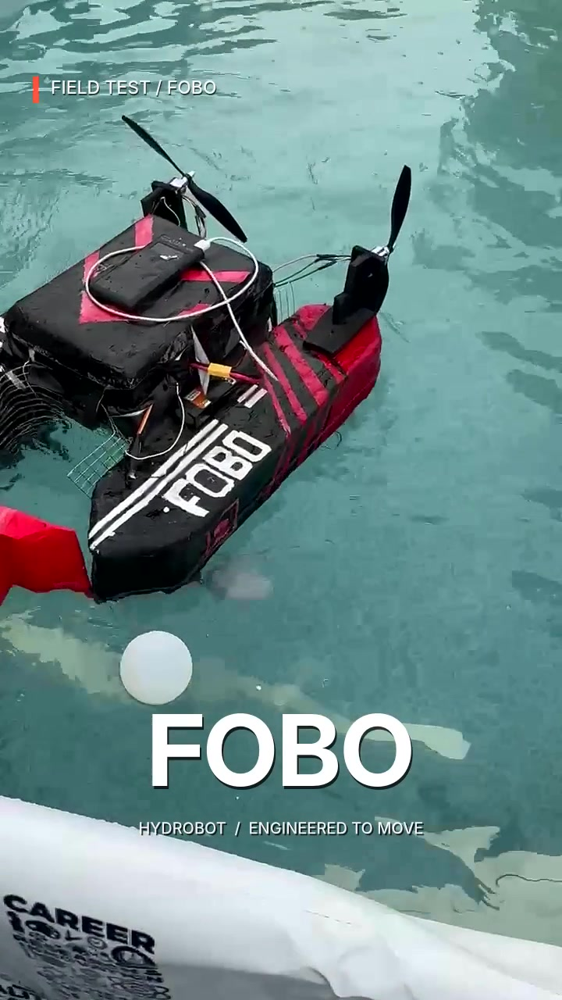
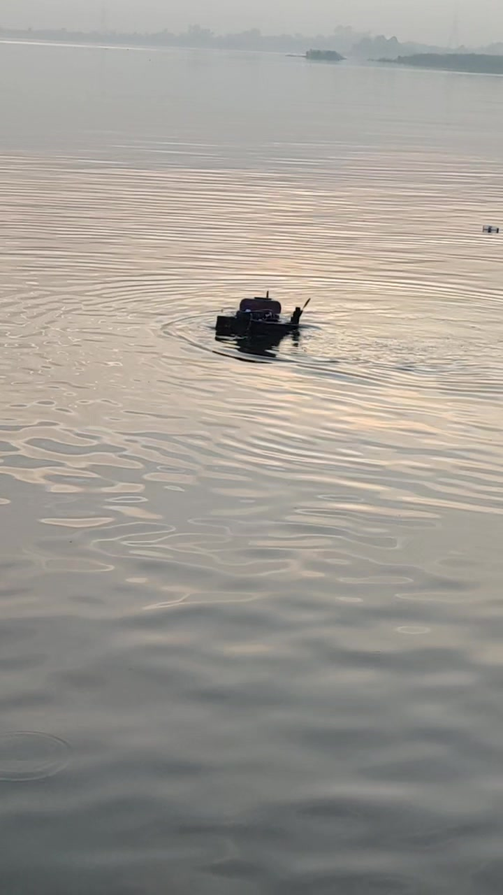

# FOBO construction and operation

These photographs and video excerpts show the physical project. Source filenames, extraction times and processing are listed in the [media record](../assets/build/README.md).

## Construction

| Shaped XPS hull pieces | Joined foam hull and bridge |
| --- | --- |
|  |  |

| Fiberglass work on the foam body | Another fabrication view |
| --- | --- |
|  |  |

Additional source views: [foam hull from above](../assets/build/xps-twin-hull-top.png) and [fiberglass-work third view](../assets/build/fiberglass-layup-3.jpg). The fiberglass pictures are related views of the work, rather than three separately logged layup stages.

## In the pool and outdoors

| Pool view | Rear propellers and electronics bay | Outdoor view |
| --- | --- | --- |
|  |  |  |

| Rear view during play | Pool interaction | Team beside the project display |
| --- | --- | --- |
|  |  |  |

## Video

| Clip | What it shows |
| --- | --- |
| [Original short project clip](../assets/fobo-demo.mp4) | Eight seconds of the operating robot |
| [Pool maneuvering](../assets/build/pool-maneuvering.mp4) | Eight-second excerpt from original event footage |
| [Ball approach](../assets/build/pool-ball-approach.mp4) | Nine-second excerpt from original event footage |
| [Pool soccer contact](../assets/build/pool-soccer-contact.mp4) | Eleven-second excerpt alongside another robot |
| [Pool and outdoor edit](../assets/build/pool-and-outdoor-demo.mp4) | Fifteen-second edited demonstration |
| [Outdoor edit](../assets/build/outdoor-demo.mp4) | Fifteen-second edited outdoor demonstration |
| [Original outdoor trial excerpt](../assets/build/outdoor-trial-original.mp4) | Twelve seconds from the original outdoor recording, with audio omitted |

The edited reels contain captions and shot changes. The footage illustrates operation; speed, thrust, radio range and water-ingress performance were not measured from these clips.
