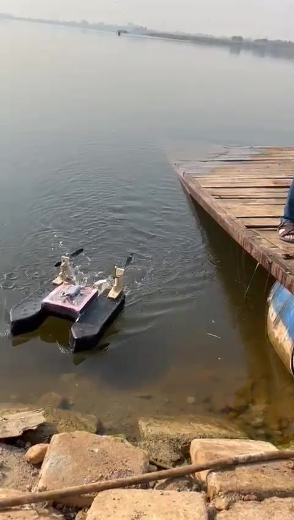

# Construction and operation

## Hull manufacture

| Shaped XPS hull and bridge | Fiberglass application |
| --- | --- |
|  |  |

The body form was shaped in XPS before fiberglass application. Early footage shows manual shaping and sanding, followed by a flotation check with a container load.

| Recording | Duration |
| --- | --- |
| [Foam shaping and sanding](../assets/build/development/foam-shaping.mp4) | 10.5 s |
| [Early hull flotation check](../assets/build/development/hull-load-check.mp4) | 7.1 s |

Additional construction views: [joined foam hull](../assets/build/xps-twin-hull-angle.png), [foam hull from above](../assets/build/xps-twin-hull-top.png), [fiberglass work 1](../assets/build/fiberglass-layup-1.jpg) and [fiberglass work 3](../assets/build/fiberglass-layup-3.jpg).

## Actuator integration

| Recording | Duration |
| --- | --- |
| [Packaged motor and propeller](../assets/build/development/motor-packaging.mp4) | 6.8 s |
| [Propulsion bench demonstration](../assets/build/development/propulsion-bench.mp4) | 5.6 s |

These views show the motor packaging and the propulsion assembly. See [mechanical design](mechanical-design.md) and [actuator protection](waterproofing.md) for the construction method.

## Open-water trials

| Launch beside the jetty | Outdoor operation |
| --- | --- |
|  |  |

| Recording | Duration |
| --- | --- |
| [Launch and movement beside the jetty](../assets/build/development/launch-trial.mp4) | 4.7 s |
| [Extended open-water trial](../assets/build/development/open-water-trial.mp4) | 80.3 s |
| [Open-water operating run](../assets/build/development/open-water-run.mp4) | 45.1 s |

## Competition pool

[Watch the competition recording](../assets/build/development/competition-run.mp4), 20.1 s.

| Rear view during play | Team beside the project display |
| --- | --- |
|  |  |

## Additional operating footage

| Recording | Content |
| --- | --- |
| [Short project clip](../assets/fobo-demo.mp4) | Eight seconds of operation |
| [Pool maneuvering](../assets/build/pool-maneuvering.mp4) | Event-footage excerpt |
| [Ball approach](../assets/build/pool-ball-approach.mp4) | Approach in the pool |
| [Pool soccer contact](../assets/build/pool-soccer-contact.mp4) | Interaction beside another robot |
| [Pool and outdoor edit](../assets/build/pool-and-outdoor-demo.mp4) | Fifteen-second project edit |
| [Outdoor edit](../assets/build/outdoor-demo.mp4) | Fifteen-second outdoor edit |
| [Outdoor trial excerpt](../assets/build/outdoor-trial-original.mp4) | Twelve-second excerpt from an outdoor recording |

The eight development recordings retain their full visual sequence and omit audio. Earlier clips include both excerpts and edited reels. Source filenames, still-frame times and encoding details are listed in the [media index](../assets/build/README.md).

[Engineering journey](build-journey.md) · [Design decisions](decision-log.md)
