# FOBO: hull, propulsion and construction

Working draft recovered from the team's November–December 2025 build discussions, the December 2025 project report, and original FOBO footage. The report contains conflicting specifications. The sealing procedure, final component specifications and dimensional drawing still need Ahmed's input before this becomes a replication guide. See the [report cross-check](report-cross-check.md).

## What the robot had to do

FOBO was built for water soccer. Directional control, pushing the ball, dodging other robots and moving toward the goal shaped the design. Its competition operation was remote-controlled.

The design discussions considered a flat-bottom arrangement, a V-shaped hull and a catamaran. The built robot uses two hulls with a central electronics compartment. The recorded reasons for choosing this arrangement were stability, maneuverability and reducing water resistance. Those were design objectives; the recovered records do not contain a measured drag comparison between the concepts.

## Hull and component arrangement

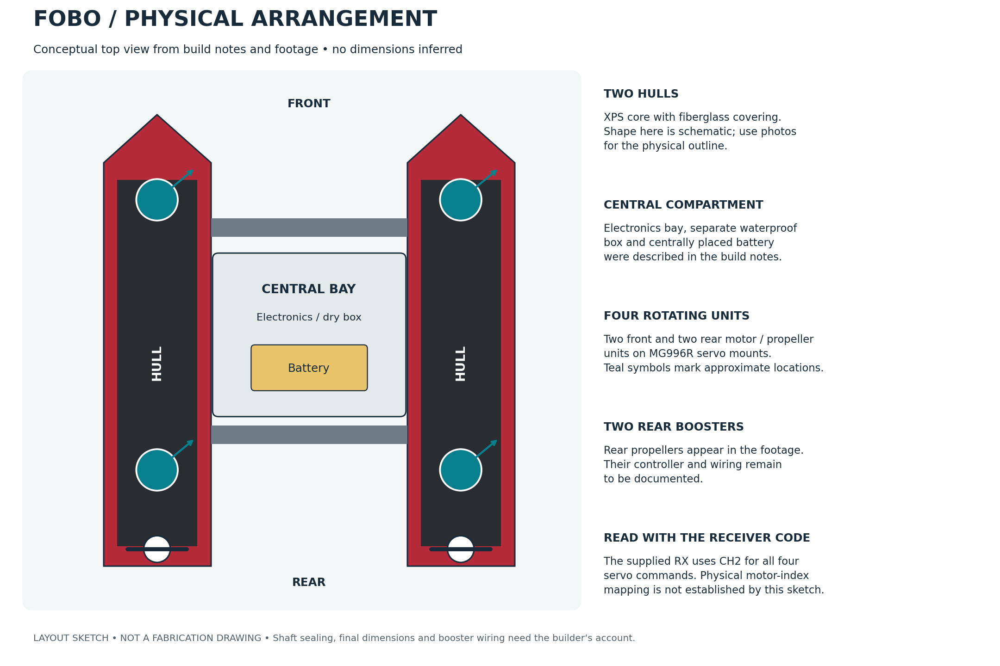

The diagram interprets the reported component arrangement. It is a layout sketch rather than a dimensional fabrication drawing. The photo gallery below shows the actual hull shape more directly.

The two hulls support the central bay and leave a gap between the floats. The foam-stage photographs show the hull outline and connecting bridge before the finished operating configuration. The battery was placed in the middle compartment inside the electronics bay. Keeping a heavy component near the middle is consistent with the recorded layout; its exact centre of gravity was not measured in the recovered material.

The November notes give an empty body mass of approximately 2.5 kg and an equipped mass of approximately 4.5–5 kg. These are reported project figures rather than a documented weighing procedure.

## Why the motors rotate on servos

The propulsion concept evolved from two thrusters plus a turning motor, to four fixed thrusters, and then to four rotatable units. The final four units were described as two at the front and two at the rear, on MG996R servo mounts.

A propeller produces thrust along its shaft direction. Rotating the complete motor/propeller mount changes that direction. This gives the operator a way to redirect the thrust while controlling motor power, which motivated the move to servo-mounted units for water-soccer maneuvering.

For a unit producing thrust T at angle δ in the horizontal plane, its force components are T cos(δ) and T sin(δ). This explains the vectoring principle; actual thrust values, angles under load and turning moments were not measured for these notes.

The included receiver sends a common angle command from CH2 to all four PCA9685 outputs. Motor speed/direction comes from CH0 and CH1. Physical mounting determines how equal servo commands orient the four units. The firmware channel map should be read together with the mechanical installation.

The notes also describe two rear booster motors, and the footage shows two raised rear propellers. Their stated purpose was stronger ball pushing and a fallback propulsion option. The recovered main firmware controls four IBT-2 motors and four servos; the booster controller, wiring and operating procedure have not yet been recovered.

## Construction recorded during the build

| Part | Recorded construction |
| --- | --- |
| Hull body | Shaped XPS foam with fiberglass |
| Fiberglass layup | Three basic layers overall; some curved regions were described as reaching six layers |
| Motor/mount attachments | Primarily integrated into the fiberglass, with custom wooden mounts and adhesive also used |
| Electronics bay | XPS and fiberglass structure with a separate waterproof box |
| Battery position | Inside the central compartment of the electronics bay |
| Sealing | Silicone was used; the exact joints and application method still need to be recorded |

The design discussions identify motor mass and local cost as constraints: approximately 300 g per motor was recorded, while lighter high-thrust alternatives were beyond the available budget. This is a useful part of the design history, rather than a claim that the installed motors were an optimum choice.

### Construction photos

| Shaped XPS hull pieces | Joined foam structure | Foam structure from another angle |
| --- | --- | --- |
| 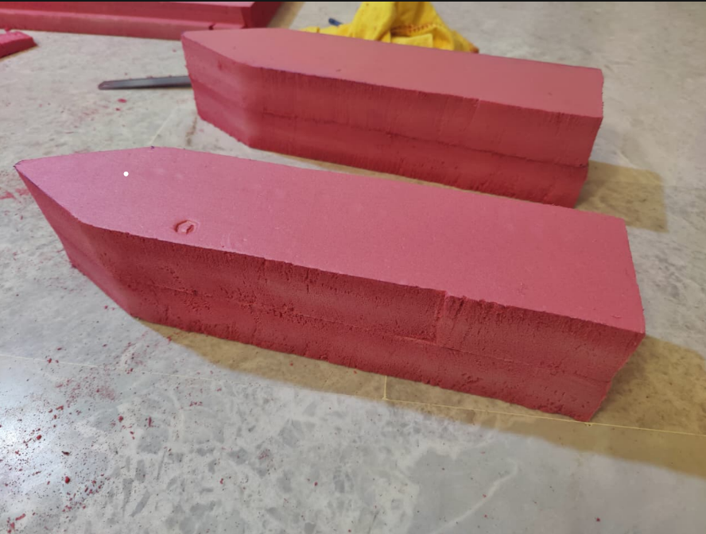 | 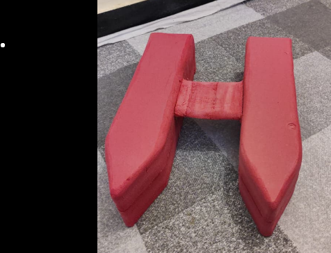 | 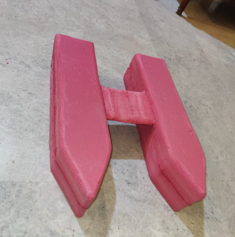 |

| Fiberglass work | Fiberglass work, second view | Fiberglass work, third view |
| --- | --- | --- |
| 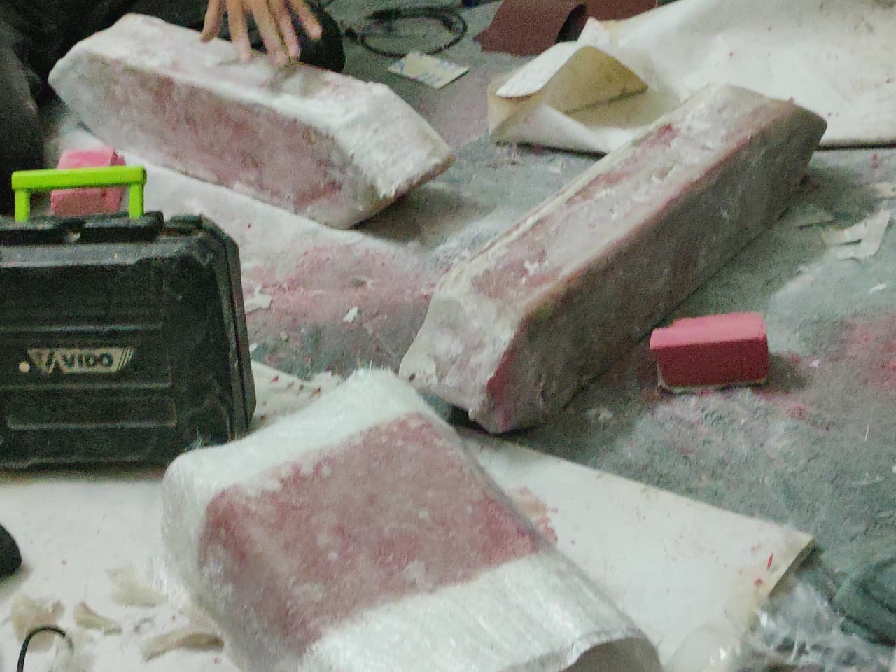 | 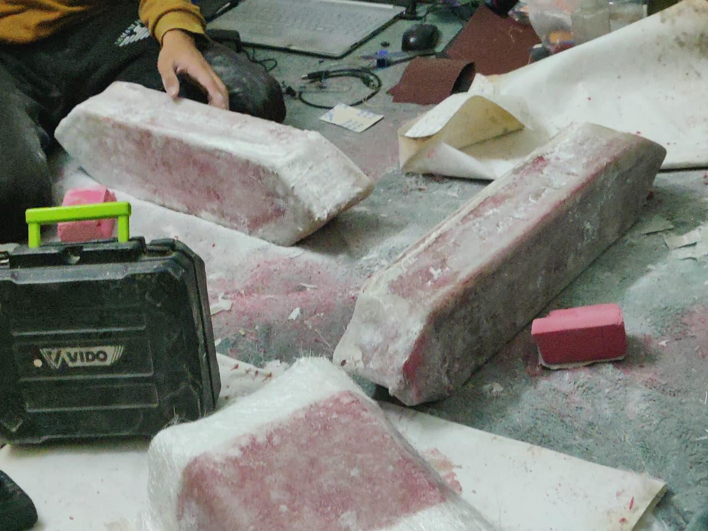 | 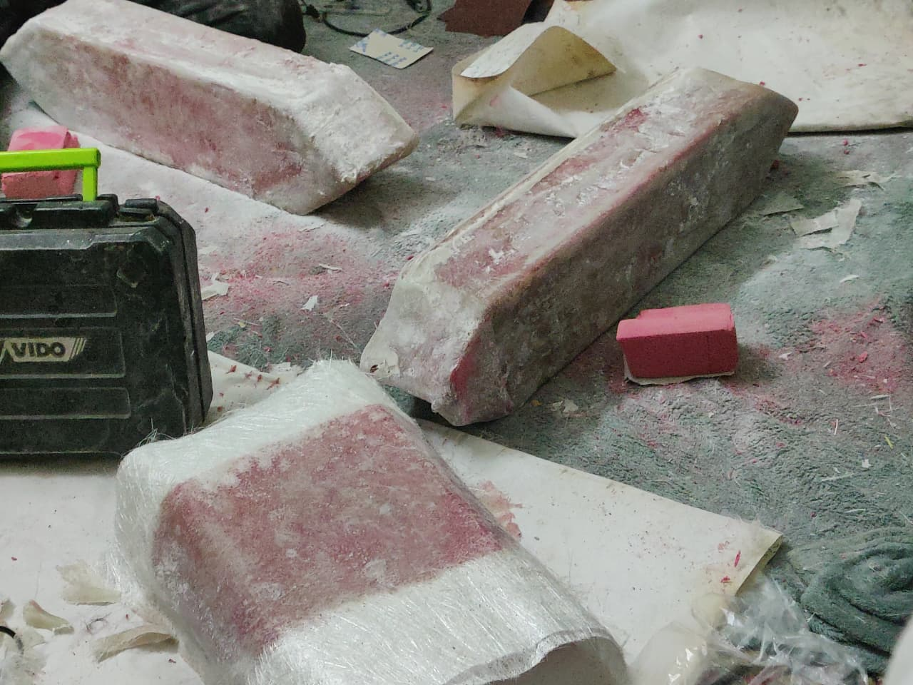 |

These six photographs are recovered from the report's fabrication-photo page, PDF page 49. The three fiberglass pictures are closely related views, rather than evidence of three separately documented layup stages.

The report describes hot-wire shaping followed by sanding, additional reinforcement around corners and mounts, and a finishing coat. Its stated 24–36 hour curing time is a report claim, not a resin specification. The actual resin, cloth weight, mixing ratio, curing conditions and mounting dimensions still need to be recorded. A builder should use the instructions for the resin they actually select.

## Waterproofing: confirmed construction and missing procedure

The documented enclosure arrangement combines the fiberglass-covered XPS body, the electronics bay, a separate waterproof box and silicone sealing. The battery is inside the central bay.

The report's Section 9.3.1 says motor-housing seams were sealed with silicone, the shaft area was protected using epoxy and silicone, and cable exits were sealed and checked under water. Section 7.5 also mentions possible O-rings or cable glands, without identifying a specific installed arrangement. These statements need Ahmed's confirmation before being converted into step-by-step instructions, particularly the treatment of the moving shaft.

The exact method used on servo cases/output shafts, the box lid and cable entries is still missing. The term “waterproof thruster” appears in the build notes, but it does not establish a commercial water-ingress rating or a reproducible sealing method. The final guide needs the materials and steps that were actually used, together with observations from operation.

Earlier chat suggestions included several possible motor-pod and sealing methods. They have not been presented here as the built method.

## Dimensions awaiting reconciliation

The November discussion reports about 23 inches in length, 17–18 inches in total width and 13 inches in height. It also mentions an 18 × 18 × 18 inch constraint. Those statements conflict. A final measured envelope, with a clear statement of whether propellers and mounts are included, is needed before publishing a dimensioned plan or a competition-compliance claim.

## Views of the actual robot

| Pool close-up | Pool overview | Outdoor view |
| --- | --- | --- |
| 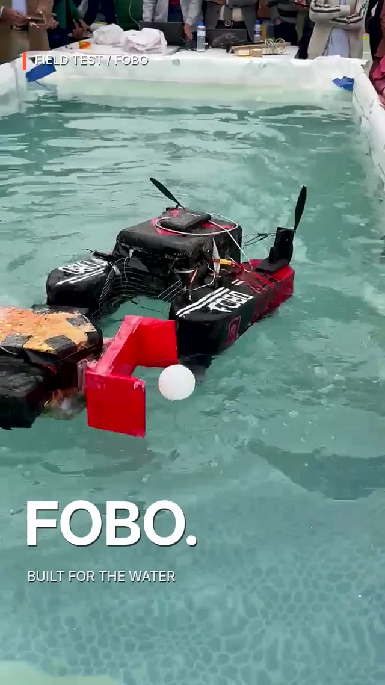 | 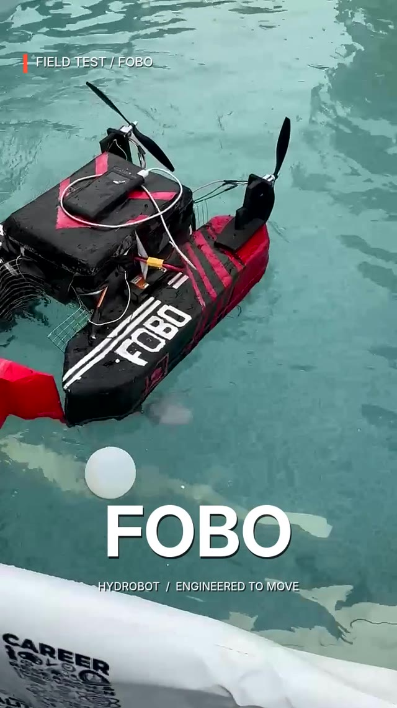 | 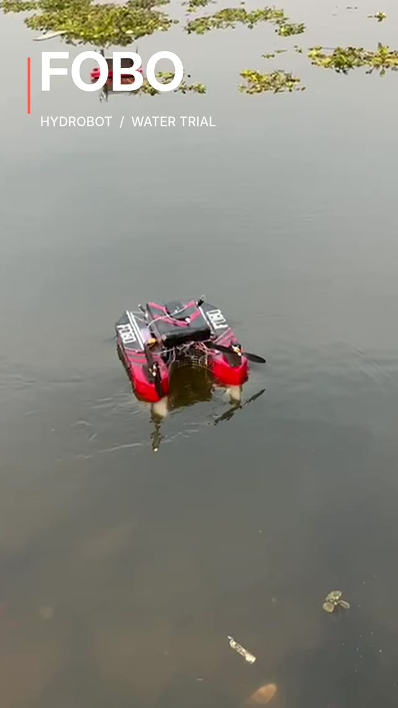 |

These are frames from existing edited project videos. The reels contain captions and cuts; their timing is not a continuous instrumented trial.

- [Pool and outdoor demonstration, 15 seconds](../assets/build/pool-and-outdoor-demo.mp4)
- [Outdoor demonstration, 15 seconds](../assets/build/outdoor-demo.mp4)
- [Pool maneuvering, 8-second excerpt from original footage](../assets/build/pool-maneuvering.mp4)
- [Pool ball approach, 9-second excerpt from original footage](../assets/build/pool-ball-approach.mp4)
- [Pool soccer contact, 11-second excerpt from original footage](../assets/build/pool-soccer-contact.mp4)
- [Media origins and processing](../assets/build/README.md)

| Rear propellers and electronics bay | Pool interaction | Team at the event |
| --- | --- | --- |
| 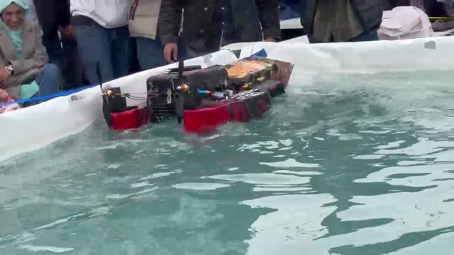 | 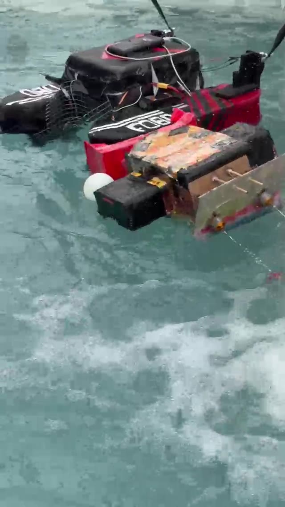 | 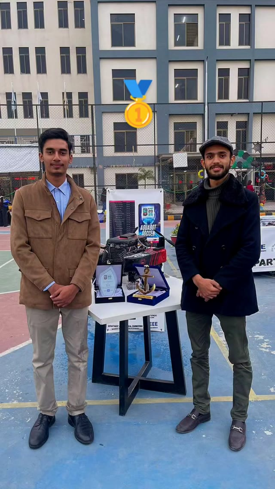 |

Motor/servo sealing close-ups and the original measured sketches would make the fabrication procedure easier to reproduce. The outdoor and pool clips show operation; they do not establish speed, thrust, range, ingress protection or automatic heading-control performance.
