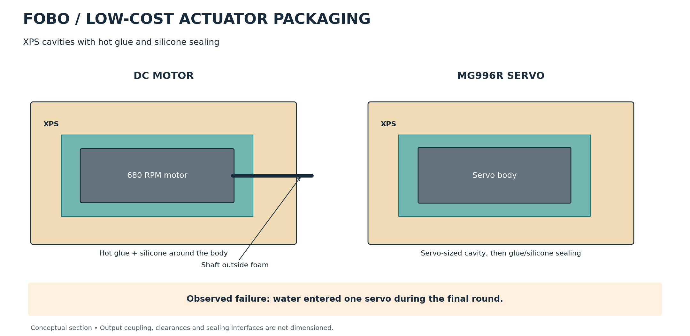
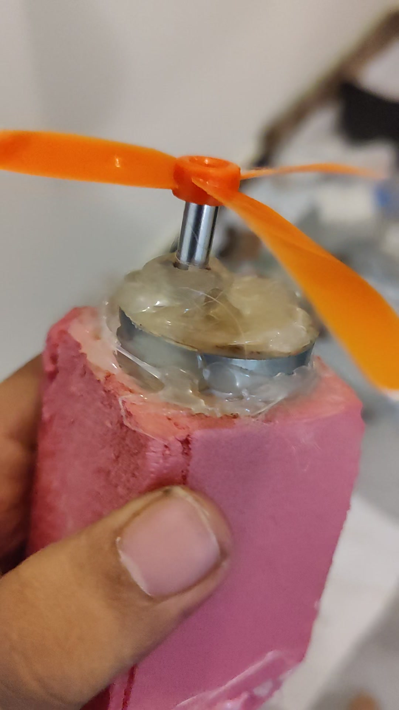

# Actuator protection and sealing

FOBO adapted ordinary DC motors and servos for the water environment using XPS cavities, hot glue and silicone. This kept the protection method within the project's component and fabrication budget.

## DC motor packaging

1. Form a motor-sized cavity in XPS foam.
2. Place the motor inside with its shaft extending outside the foam.
3. Fill and seal around the motor body using hot glue and silicone.

[Watch the packaged motor](../assets/build/development/motor-packaging.mp4)

The surrounding foam encloses the motor body while the shaft remains available to drive the propeller.

## Servo packaging

1. Form a servo-sized cavity in XPS foam.
2. Place the servo into the cavity.
3. Apply glue and silicone around the servo body.

The servo output couples to the rotating motor mount. The packaging therefore has to protect the actuator while allowing the mount to move.

## Hull and electronics bay

The hull was shaped in XPS and covered with fiberglass. The central compartment contained the electronics and battery, with a separate protective box and silicone-sealed enclosure interfaces described in the construction account.

## Operating lesson

During the final round, water entered one servo and it stopped working. The arrangement otherwise supported operation through the project.

A further enclosure revision should focus on serviceable actuator interfaces and repeated exposure checks while the mounts operate. The failure makes sealing a mechanical design task alongside thrust direction, mounting stiffness and power delivery.

[Mechanical design](mechanical-design.md) · [Build footage](gallery.md#actuator-integration) · [Engineering journey](build-journey.md)
